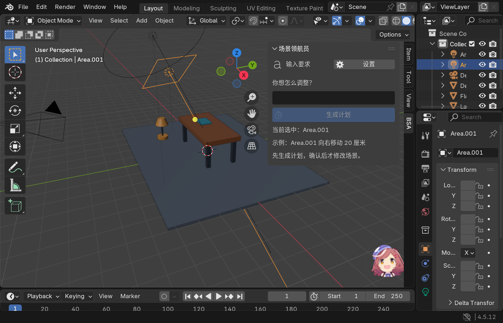

# 场景领航员

场景领航员 0.6.3 开发版是一款面向 Blender 4.5 LTS 的中文 AI 场景编排插件。安装后，3D 视图右下角会出现一个可点击的二维助手形象；点击它即可输入中文要求。插件会先生成计划，只有用户确认后才通过事务执行，并在完成后验证结果。

0.6.3 根据用户反馈简化界面：主屏只显示当前阶段、输入或计划、一个主要动作；AI 服务、精确控制、助手显示开关和用量从“设置”打开。不再显示大头像、重复对话和重复错误。用户指定角色图仍占用 92 × 92 像素；用户已确认拥有使用权并要求提交到公开仓库，项目继续保留来源和处理记录。GitHub Releases 安装包在创建 0.6.3 Release 前仍为 0.6.2。

0.6.2 增加 LM Studio 结构化输出适配，已用本机 `qwen/qwen3-4b-2507` 在 Blender 4.5.12 跑通真实规划和确认执行。提示词澄清后，一轮固定任务通过 20/20，其中真正调用模型的正向任务为 8/8；先前一轮为 18/20，两个矛盾约束被回滚。保留两轮结果，不能据此宣称任意指令都可靠。详见 [本版中文测试报告](docs/RELEASE_0.6.2_TEST_REPORT.md)。

0.6.1 新增本地生成的实际动作清单、AI 解锁保护，以及 20 个固定任务的独立评测。模型摘要只供参考，不能替代确认清单。符合动作协议并不等于符合用户意图，请逐项检查对象、方向、距离和保护约束。

0.6.0 第一次打通了 AI 结构化规划：本地解析器能可靠理解的指令完全离线处理；其他指令先展示本轮将发送的数据，用户点击“同意并调用 AI”后才访问自己配置的 OpenAI-compatible 服务。模型只能提出白名单动作，不能执行 Python，也不能直接修改 Blender。

仓库另有一条尚未进入正式插件 UI 的“参数化电路板外壳”实验轨。P0 已完成毫米制参数推导和
FDM 最小规则检查；P1 已在 Blender 4.5.12 中事务化创建装配预览并验证失败回滚。它目前不是
可直接打印的最终网格，准确范围见 [P1 中文说明](docs/PARAMETRIC_ENCLOSURE_P1.md)和
[P1 开发者测试报告](docs/PARAMETRIC_ENCLOSURE_P1_TEST_REPORT.md)。

新的正式方向是“3D 打印零件助手”：既支持用户直接按尺寸创建，也支持 AI 根据用途引导测量、
提出受支持的结构候选和生成参数修改。它将复用现有用户自带 API 设置；AI 只产生严格候选，
不能直接执行 Python 或修改 Blender。完整边界见
[3D 打印零件助手方案 V0.1](docs/3D_PRINT_PART_ASSISTANT_PLAN_V0.1.md)。

## 安装后会看到什么

1. 3D 视图右下角出现“场景领航员”助手形象。它只是界面入口，不是场景物体，不会进入渲染或导出。
2. 点击助手后出现中文输入面板；也可以把鼠标放在 3D 视图中按 `N`，从 `BSA` 标签打开同一面板。
3. 明确指令由本地解析器直接生成计划；模糊指令先显示“本轮发送数据”，此时没有联网，也没有修改场景。
4. 用户同意调用 AI 后，界面进入规划状态；AI 返回的候选计划还要经过本地严格校验。
5. 计划通过后显示本地生成的实际动作、约束和“确认并执行”按钮，此时场景仍不会改变。模型摘要另列为建议说明。
6. 用户确认后，所有修改统一经过事务、执行器和验证器；失败会回滚或明确停止。

0.6.3 简洁主屏（右下角头像保持 92 × 92 像素）：



需要 AI 时，插件仍会在联网前展示本轮实际发送数据，并提供“同意发送并生成计划”和“不发送，返回输入”。

## 安装方法

本机当前安装包为 `dist/blender_scene_assistant-0.6.3.zip`。在 0.6.3 Release 创建前，可从 [GitHub 0.6.2 测试版发布页](https://github.com/53wei/blender-plugin/releases/tag/v0.6.2) 下载旧版 `blender_scene_assistant-0.6.2.zip`。请不要把 GitHub 自动生成的“Source code”压缩包当作插件安装包。

本地已构建的安装包位于 `dist/blender_scene_assistant-0.6.3.zip`，构建产物不放入源码历史。当前版本为开发者测试版，尚未上架 Blender 官方扩展平台，也未完成真实资产及外部用户验收。

在 Blender 4.5 中打开“编辑 → 偏好设置 → 获取扩展”，从右上角菜单选择“从磁盘安装”，选中 ZIP 并启用。使用本地新界面时请替换为 0.6.3，再保存项目并重启 Blender。

如果没有现成物体，可以打开项目中的 `tests/fixtures/desk_lamp_demo.blend`。其中已经有 `Desk` 和 `Lamp`，可直接测试：

- `把 Lamp 放到 Desk 右侧，并锁定 Desk`：本地生成计划。
- `Lamp 向左移动 20 厘米`：本地生成定距移动计划。
- `解除锁定 Desk`：本地生成解锁计划。
- `重新安排 Lamp 和 Desk，让画面更紧凑`：进入 AI 数据确认流程。

每次都先检查计划，再点击“确认并执行”。也可从“设置 → 精确控制”手动选择物体、目标和摆放区域。

## 使用自己的 API

1. 点击视图右下角助手，或从 `N → BSA` 打开面板。
2. 点击右上角“设置”，填写“AI 服务”。
3. 填写 OpenAI-compatible API 地址；远程地址必须使用 HTTPS，本机服务可以使用 `http://127.0.0.1` 或 `http://localhost`。
4. 填写模型名和临时 API Key。Key 只保留在当前 Blender 会话，也可通过 `BSA_API_KEY` 或 `OPENAI_API_KEY` 环境变量提供。
5. 点击“测试连接”，检查地址、认证和模型是否可用。
6. 返回助手，输入一条要求，点击“生成计划”。
7. 需要 AI 时检查对象摘要，也可展开“完整发送详情”。只有点击“同意发送并生成计划”后才真正发送。
8. 检查 AI 计划，再点击“确认并执行”。

如果提示“Blender 当前禁止扩展联网”，请到“编辑 → 偏好设置 → 系统”启用“允许联网访问”。不同兼容服务对 `/models`、`/chat/completions` 和 JSON 输出的支持并不完全相同；连接测试成功不保证所选模型一定能生成合格计划。

### 本机 LM Studio 的填写示例

先在 LM Studio 加载聊天模型并启动本地服务器，再打开插件的“设置 → AI 服务”：

| 设置 | 本机已实测的值 |
|---|---|
| API 地址 | `http://127.0.0.1:1234/v1` |
| 模型 | `qwen/qwen3-4b-2507`（以本机列表为准） |
| 输出格式 | `LM Studio 结构化输出` |
| API Key | 服务未启用认证时留空；若设置过 Key 环境变量，也需清除它们 |

同一台电脑优先填 `127.0.0.1`，不要照抄截图中的 `172.25.96.1`；插件拒绝非回环地址的明文 HTTP。输出格式默认仍是“通用 JSON”，不会自动切换或自动降级。旧版本在当前 LM Studio 上会因 `json_object` 不兼容而返回 HTTP 400。

`qwen3-vl-4b-instruct` 已做单独安装版测试：地址和模型可以连接，但它没有生成插件要求的严格结构化计划，因此 0.6.3 暂不把它列为推荐模型。测试被安全拦截，场景没有改变。当前请使用上表中的 `qwen/qwen3-4b-2507`；不需要云端 API Key。

打开演示场景后输入：`让 Lamp 落在 Desk 顶面的右侧，Desk 保持原样`。点击“生成计划”，检查发送数据，再点“同意发送并生成计划”；核对实际动作后点“确认并执行”。这是已实测的 AI 路径。明确的 `把 Lamp 放到 Desk 右侧` 走本地解析，不会调用模型。

## 当前已经完成

- 可点击、可隐藏的二维助手入口和中文交互面板；头像来源与用户授权状态单独记录。
- 本地解析明确的摆放、定距移动、锁定和解除锁定指令。
- AI 调用前的数据预览和逐次用户同意，不会静默上传场景。
- 最多 20 个相关可见对象的最小上下文构建与稳定筛选。
- OpenAI-compatible 结构化规划、一次 JSON 修复机会和用量显示。
- 严格候选计划协议；拒绝未知字段、未知动作、错误对象和危险参数。
- 模型不能提供可信场景指纹、确认标志或任意 Python；这些信息由本地主进程生成。
- 场景指纹、过期结果拒绝、事务执行、失败回滚和结果验证。
- 会话级 API Key、HTTPS 限制、联网权限、超时、取消和隔离网络子进程。
- Key 不写入 `.blend`、命令行或日志；模型失败、取消和超时都不会修改场景。
- 纯 Python 测试、Blender 4.5 后台集成测试、隔离安装测试和 20 次重复验证。
- 实验轨可从严格毫米参数创建 12 部件电路板外壳装配预览；创建需要确认，尺寸不一致会完整回滚。

## 当前不能做什么

0.6.3 只允许 AI 使用已经验证过的 `place_on`、`move` 和 `lock` 动作。AI 不能自行解锁；需要先用本地明确指令 `解除锁定 Desk` 并确认。它不会自动建模，不会创建、删除或编辑网格，不会修改材质、灯光或相机，也还不能完成真正的多物体构图、环形排列、对齐和分布。

上述限制描述的是 0.6.3 正式插件界面。仓库中的外壳 P1 只能由开发测试入口生成装配预览，
还没有参数面板、自然语言入口、布尔开孔、螺丝孔、流形检查或导出，不能作为“AI 已经会建模”
的证据。

自然语言理解范围变大了，但执行能力仍受白名单限制。“做成高级感”之类要求如果无法映射到现有动作，会得到明确错误，而不是让模型自由控制 Blender。表面摆放仍只支持能用水平世界坐标边界框可靠表达的支撑面。

## 开发测试

```powershell
python demos/run_core_demo.py
python -m unittest discover -s tests -p "test_*.py" -v
python -m benchmarks.runner --case ai_01
python -m benchmarks.runner --mode replay
blender --command extension validate
blender --command extension build --output-dir dist
blender --background --factory-startup --python-exit-code 1 --python tests/integration/run_m1_suite.py
blender --background --factory-startup --online-mode --python-exit-code 1 --python tests/integration/run_provider_ui_suite.py
.\scripts\run_m2_blender_tests.ps1 -Blender "blender" -Repeat 20
```

真实模型评测步骤和请求上限见 [中文评测说明](docs/MODEL_EVALUATION.md)。默认只审查公开合成数据，不联网；回放通过率不是 AI 准确率。

本版已脱敏、只含公开合成夹具的 [验收证据快照](docs/evidence/0.6.2/README.md) 同时保留失败与修复后结果。日常生成的 `benchmarks/results/` 仍默认忽略，真实 Key、用户资产、原始模型正文与本机临时目录不提交。

详细产品阶段见 `docs/AI_PRODUCT_IMPLEMENTATION_PLAN.md`，数据边界见 `docs/PRIVACY.md`，完整测试步骤见 `docs/SELF_TEST_PROTOCOL.md`。在真实外部用户使用自己的资产复用之前，0.6.3 的结果仍应称为“开发者测试”，不能称为“用户验证”。
